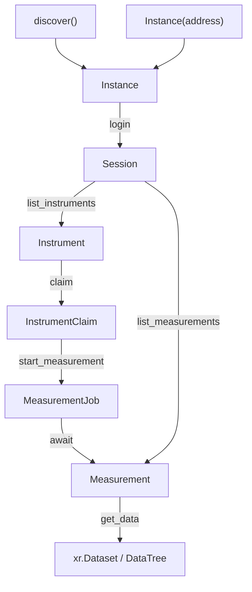

# Concept

The Lablink API is built around a small, consistent vocabulary. Once you know the pattern, every part of the API follows it.

## References, handles, and data

Every object the API gives you falls into one of three categories:

1. **References**: lightweight pointers to things that live on the Lablink server. A reference carries no measurement data — just an identifier (a GUID, serial, or address) and a link back to the [Session][pypalmsens.lablink.Session] it came from. They are cheap to create, cheap to hold, and cheap to print. But they are live, not snapshots: a reference only works while its session is alive. The durable thing to store is the identifier, not the object.
2. **Handles**: live objects with capabilities and a lifecycle. They do things: a [Session][pypalmsens.lablink.Session] holds an authenticated connection, an [InstrumentClaim][pypalmsens.lablink.InstrumentClaim] holds an exclusive claim on an instrument, a [MeasurementJob][pypalmsens.lablink.MeasurementJob] tracks a running measurement.
3. **Data**: the payload itself. The actual data is returned as an [xarray.Dataset][] or [xarray.DataTree][], obtained by fetching a [Measurement][pypalmsens.lablink.Measurement].

```python
refs = await session.list_measurements()   # list[Measurement] — cheap rows
data = await refs[0].get_data()            # xr.Dataset — the actual data
```

Rule of thumb: if it's a [Session][pypalmsens.lablink.Session], [InstrumentClaim][pypalmsens.lablink.InstrumentClaim] (or claim batch), or [MeasurementJob][pypalmsens.lablink.MeasurementJob], it's a live handle with a lifecycle you must release or await. If it's a pointer — [Instance][pypalmsens.lablink.Instance], [Instrument][pypalmsens.lablink.Instrument], or [Measurement][pypalmsens.lablink.Measurement] — you can hold onto it for as long as its session lives; what survives past that is the identifier. The payload itself is a bare xarray object, no Lablink wrapper.

## The type vocabulary

| Type | Category | What it is | How you get it |
|---|---|---|---|
| [Instance][pypalmsens.lablink.Instance] | Reference | A Lablink server: its address plus metadata | `await discover()` or `Instance('https://127.0.0.1/')` |
| [Session][pypalmsens.lablink.Session] | Handle | An authenticated connection to an instance. The root object — everything else hangs off it. | `await instance.login(name, password)` |
| [Instrument][pypalmsens.lablink.Instrument] | Reference | A pointer to an instrument (serial number) | `await session.list_instruments()` |
| [InstrumentClaim][pypalmsens.lablink.InstrumentClaim] | Handle | An exclusive lease on an instrument. While you hold it, no one else can use that instrument. | `await instrument.claim()` |
| [InstrumentClaimBatch][pypalmsens.lablink.InstrumentClaimBatch] | Handle | A group of claims that release together. | `await session.claim(instruments)` |
| [MeasurementJob][pypalmsens.lablink.MeasurementJob] | Handle | A handle to a running measurement. Awaitable: `await job` blocks until it finishes and returns a [Measurement][pypalmsens.lablink.Measurement]. | `await claim.start_measurement(method)` |
| [Measurement][pypalmsens.lablink.Measurement] | Reference | A pointer to a stored measurement (its GUID) | `await job` or `await session.list_measurements()` |
| `xr.Dataset` / `xr.DataTree` | Data | The actual measurement data | `await ref.get_data()` |

A single measurement comes back as a `Dataset`; one with repeated or stacked runs comes back as a `DataTree`. The measurement data API is still work in progress.

### Lifecycle of a measurement



The crucial design decision: starting a measurement returns immediately. `claim.start_measurement()` kicks off the measurement on the server and gives you a [MeasurementJob][pypalmsens.lablink.MeasurementJob] handle right away — it does not wait for the measurement to finish. This is what lets one workstation orchestrate many instruments at once. You decide when (or whether) to wait:

```python
job = await claim.start_measurement(method)   # returns immediately
# ... do other things, start more measurements ...
ref = await job                               # blocks only now, until it finishes
data = await ref.get_data()                  # the payload
```

Even if you never await the job, the measurement still runs and the server keeps its own record. The GUID that the job carries is durable — store it, and you can find the measurement again later through `session.list_measurements()` or `session.get_measurement(guid)`, then fetch with [Measurement.get_data][pypalmsens.lablink.Measurement.get_data]. `await job` is a convenience that lands on the same [Measurement][pypalmsens.lablink.Measurement].

## Claims: borrowing instruments

An [InstrumentClaim][pypalmsens.lablink.InstrumentClaim] is an exclusive lock. While you hold it, that instrument is yours; when you release it, it becomes available to others. It works like an open/close handle: you can hold it with an `async with` block, or release it by hand.

1. Always release claims, otherwise the instrument stays locked for everyone.
2. Prefer `async with`, which releases automatically, even if an error occurs:

```python
async with await instrument.claim() as claim:
    job = await claim.start_measurement(method)
    ref = await job
# claim released here, no matter what happened above
```

For manual control (e.g. a claim held for the lifetime of an application), call `claim.release()` yourself:

```python
claim = await instrument.claim()
# ... use the instrument ...
await claim.release()
```

## Batches: many instruments at once

Operations come in singular/plural pairs. The singular lives on the object (`claim.start_measurement`, `instrument.claim`); the batch lives on the session and works on every item at once.

```python
async with await session.claim(instruments) as claims:
    jobs = await session.start_measurement(claims, method=method)
    refs = await asyncio.gather(*jobs)
```

Notes on batches:

- [Session.claim][pypalmsens.lablink.Session.claim] claims all instruments in a single server call and returns an [InstrumentClaimBatch][pypalmsens.lablink.InstrumentClaimBatch].
- `claims` in the block above is the list of individual [InstrumentClaim][pypalmsens.lablink.InstrumentClaim]s. When the block exits, every claim in the batch is released (or call `await batch.release()` for manual control).
- `session.start_measurement(claims, method=...)` returns one [MeasurementJob][pypalmsens.lablink.MeasurementJob] per instrument — a `list[MeasurementJob]`.
- `asyncio.gather(*jobs)` raises if any measurement fails. To handle failures per-instrument instead of aborting:

  ```python
  results = await asyncio.gather(*jobs, return_exceptions=True)
  ok      = [r for r in results if not isinstance(r, BaseException)]
  failed  = [r for r in results if isinstance(r, BaseException)]
  ```

## Conventions

- Async methods do I/O. Anything that talks to the server or an instrument is `await`-able. Anything cheap and local (metadata on a reference, properties on a [MeasurementJob][pypalmsens.lablink.MeasurementJob]) is a plain attribute.
- `list_*` methods return references. `session.list_measurements()` gives you pointers to rows. Call `.get_data()` on one to get the payload.
- Data comes back as xarray. A finished measurement is an `xr.Dataset` (single run) or `xr.DataTree` (stacked runs) from `get_data()`.
- Everything prints usefully. `print(ref)` shows the serial number, GUID, or address.
